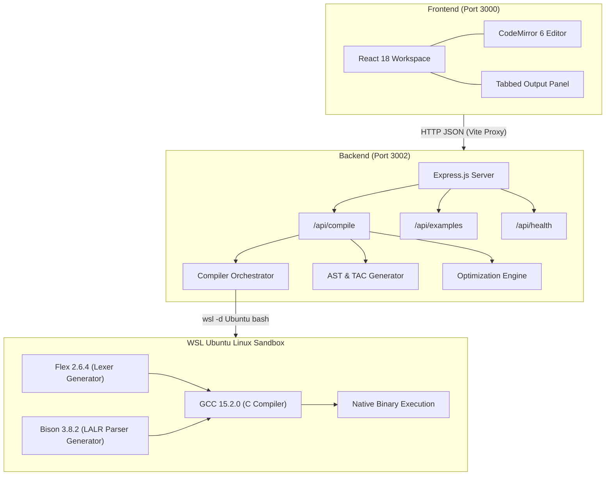

# Lexora — System Architecture Documentation

## 1. System Overview

Lexora is built using a clean, decoupled three-tier architecture specifically designed for college Compiler Design demonstrations without external database or authentication dependencies.

---

## 2. Component Breakdown

### Frontend (`frontend/src/`)
- **React 18 + Vite**: High-performance single page workbench with hot module replacement and instantaneous proxying.
- **CodeMirror 6**: Code editor supporting line numbering, active line gutter highlights, parentheses matching, and syntax coloring.
- **Components**:
  - `Header`: System branding, example project switching, status indicator, compile trigger button.
  - `FilePanel`: File selector (`.l`, `.y`, `input.txt`), file size tracking, pipeline flow chart.
  - `CodeEditor`: CodeMirror wrapper with dynamic file type binding.
  - `OutputPanel`: Multi-tab panel displaying Console Output, Token Table, Syntax Tree, Symbol Table, Three-Address Code, Optimization Comparison, and Basic Blocks.

### Backend (`backend/`)
- **Express Server (`server.js`)**: Runs on port 3002, handles incoming JSON requests.
- **Input Validation (`validator.js`)**: Validates presence of fields, size limits (< 100KB), and null-byte detection.
- **WSL Execution Runner (`wslRunner.js`)**: Shells out safely via `wsl -d Ubuntu bash -c` with isolated working directories and bash `timeout 10` guards.
- **Compiler Orchestrator (`compiler.js`)**: Coordinates the Flex → Bison → GCC → Execute pipeline and integrates educational visualization modules.
- **Educational Compiler Modules**:
  - `tokenExtractor.js`: Lexical tokenizer recording token types, lexemes, lines, and character positions.
  - `astGenerator.js`: Recursive-descent parser producing hierarchical Abstract Syntax Trees.
  - `semanticAnalyzer.js`: Scope and declaration analyzer generating the Symbol Table and detecting undeclared identifiers.
  - `tacGenerator.js`: Syntax-Directed Translation engine producing Quadruples and linear Three-Address Code.
  - `optimizer.js`: Constant Folding, Algebraic Simplification, and Constant Propagation engine.
  - `basicBlocks.js`: Leader-rule detection algorithm partitioning TAC into basic blocks (B1, B2...).

---

## 3. Security & Sandboxing

1. **UUID-isolated Temp Directories**: Every compilation run is assigned a unique UUID directory inside `os.tmpdir()`. No concurrent request collisions.
2. **Path Sanitization**: User input is strictly written to isolated temporary files (`lex.l`, `parser.y`, `input.txt`) and never directly interpolated into shell command strings.
3. **Execution Timeouts**: Enforced at two layers:
   - Bash level: `timeout 10 <command>`
   - Node process level: `exec({ timeout: 13000 })`
   Protects against infinite loops in user-defined grammar actions.
4. **Deterministic Temp Cleanup**: Temp directories are deleted recursively in a `finally` block regardless of compilation outcome.
